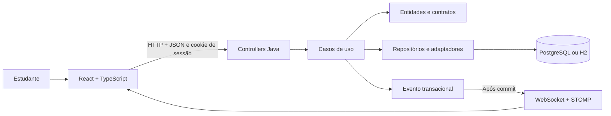
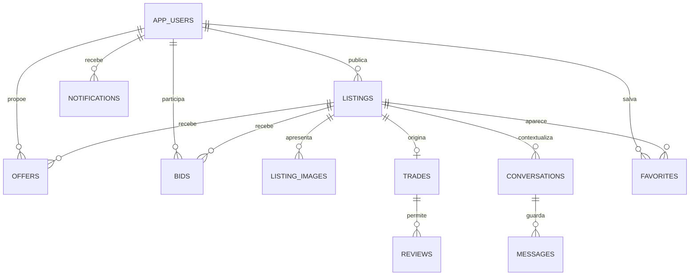
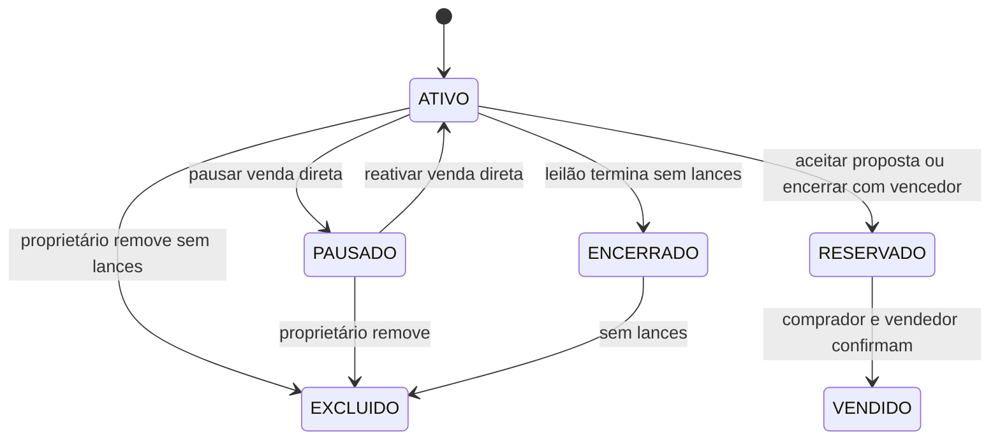
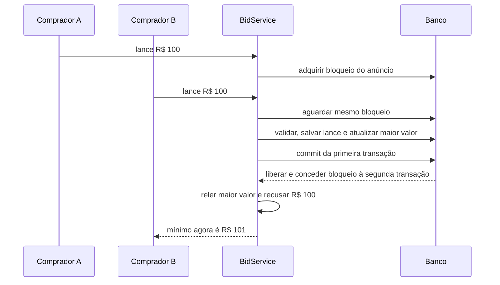

# Arquitetura e modelagem

## Visão geral

O CampusMarket é um monólito modular: uma aplicação Java com funcionalidades separadas por pacotes. O React apresenta as telas; a API executa as regras e persiste os dados. Esta escolha mantém o projeto compreensível e permite executar transações sem comunicação entre microsserviços.

## Responsabilidades

| Elemento | O que faz | Exemplo |
| --- | --- | --- |
| Controller | Traduz HTTP e valida a forma da entrada. | `AuthController`, `BidController` |
| Caso de uso | Coordena operações, dependências e transação. | `RegisterUser`, `CloseAuction` |
| Entidade | Protege invariantes e transições do próprio estado. | `Listing.placeBid`, `Trade.confirm` |
| Porta | Define uma capacidade necessária ao consumidor. | `UserAccounts`, `ImageStorage` |
| Adaptador | Implementa uma porta utilizando uma tecnologia. | `JpaUserAccounts`, `LocalImageStorage` |
| DTO | Representa os dados de entrada e saída da API. | `ListingService.View`, `AuthController.Me` |

É uma arquitetura em camadas pragmática. As entidades utilizam anotações JPA e alguns serviços dependem diretamente de interfaces Spring Data. O cadastro possui portas independentes do framework para demonstrar DIP de forma explícita. Não se trata de uma implementação integral de arquitetura hexagonal.

## Relações principais

O esquema detalhado está em `backend/src/main/resources/db/migration/V1__initial_schema.sql`.

Um estudante pode comprar e vender. Os papéis pertencem à negociação; não existem subclasses de usuário baseadas nessas atividades.

`Listing` é a raiz do agregado do anúncio. Ela contém a modalidade, os dados do produto, os valores da disputa e o estado. `BidService` executa operações de leilão; `NegotiationService` cuida das propostas e negociações. Não existe uma hierarquia `VendaDireta extends Leilao` nem um contrato que prometa lances para qualquer modalidade. A validação da modalidade na entidade protege seu estado.

## Encapsulamento

Os atributos das entidades são privados. O JPA utiliza acesso por campos; os métodos de leitura têm nomes como `id()` e `price()`. Não existem setters genéricos para situação, maior lance ou conclusão. Mudanças passam por métodos como `placeBid`, `reserve`, `confirm` e `complete`.

Os construtores sem argumentos são protegidos e existem para o JPA. Os construtores públicos e métodos de domínio verificam as regras. Objetos monetários usam `BigDecimal`, e os horários são armazenados como `Instant`.

## Transições de um anúncio

Um anúncio reservado não recebe novas propostas. Não há cancelamento ou estorno implementado nesta versão. Registros com lances ou negociações não podem ser apagados por ações do catálogo.

## Concorrência dos lances

`ListingRepository.lockById` utiliza `PESSIMISTIC_WRITE`. O bloqueio dura até o fim da transação de `BidService.place`. O valor e o prazo são verificados depois da aquisição do bloqueio. A rotina de encerramento usa o mesmo bloqueio.

O relógio é injetado por `Clock`, permitindo testar o limite exato do prazo sem esperar horas. O contador exibido na tela é informativo; a aceitação usa o relógio do servidor.

`AuctionScheduler` consulta leilões vencidos a cada cinco segundos e chama o bean `CloseAuction`. Manter o caso de uso em outro bean garante a interceptação de `@Transactional`. Repetir o encerramento não cria outra negociação: a transição de estado e a unicidade de `trades.listing_id` protegem a operação.

## Sessão e comunicação em tempo real

O login autentica pelo Spring Security e salva a identidade numa sessão HTTP. O navegador recebe um cookie HttpOnly. A API fornece um token CSRF que o frontend envia nas operações de escrita. O identificador do autor vem da sessão, não do JSON.

O handshake de WebSocket exige a sessão autenticada e a mesma origem. O cliente só pode assinar `/topic/catalog` e sua própria fila `/user/queue/updates`. Operações de escrita continuam na API HTTP, com CSRF e autorização. Não há envio de mensagens de chat por destinos STOMP livres.

O canal público transmite apenas a mudança de um anúncio. Avisos privados são enviados por usuário. A invalidação ou expiração da sessão fecha os sockets associados por meio de `SocketSessions`.

Eventos de catálogo e notificações são divulgados por `@TransactionalEventListener(AFTER_COMMIT)`. Assim, a tela não recebe um sucesso de uma operação que ainda pode sofrer rollback. O frontend também recarrega os dados ao recuperar foco e a cada 20 segundos, cobrindo reconexões e perda de avisos.

## Persistência e imagens

O perfil `demo` utiliza H2 em arquivo. O perfil `postgres` utiliza PostgreSQL. Ambos aplicam a mesma migração Flyway e utilizam `ddl-auto: validate`, evitando alterações automáticas e silenciosas no esquema.

As imagens enviadas têm limite de 5 MB e 16 megapixels. O backend verifica o conteúdo, normaliza para JPEG, reduz o maior lado a 1600 pixels e grava um identificador aleatório. O caminho de leitura é validado para impedir acesso fora da pasta de uploads. `ImageStorage` permite trocar a implementação de disco futuramente.

## Decisões de escopo

O sistema intermedeia o contato e registra as confirmações. Não processa pagamentos, não verifica entregas físicas e não consulta uma faculdade real. Esses limites fazem parte da proposta apresentada, e não devem ser anunciados como funcionalidades prontas.
