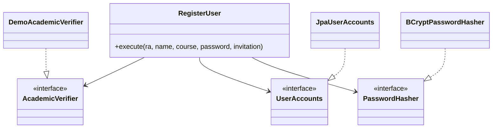

# SOLID com evidências no código

SOLID reúne princípios de projeto orientado a objetos. Repository, Adapter e Observer são padrões de projeto; Spring Boot é um framework. Esses termos se relacionam, mas não são sinônimos.

Todos os caminhos abaixo partem da raiz `campus-market`. As evidências se concentram no backend Java. No React, os componentes funcionais e hooks seguem divisão de responsabilidades sem introduzir classes artificiais.

## S — Single Responsibility Principle

Uma classe deve ter um motivo principal para mudar, associado a uma responsabilidade coerente.

No cadastro:

- `usuarios/api/AuthController.java` trata a interação HTTP.
- `usuarios/application/RegisterUser.java` coordena o caso de uso.
- `usuarios/infrastructure/DemoAcademicVerifier.java` conhece a base acadêmica fictícia.
- `usuarios/infrastructure/BCryptPasswordHasher.java` adapta a geração de hash.
- `usuarios/infrastructure/JpaUserAccounts.java` adapta a persistência.

Esses arquivos estão sob `backend/src/main/java/br/edu/campusmarket`.

**Mudança concreta:** se a faculdade fornecer uma API de matrícula, a consulta dessa API será implementada num validador. Não precisará ser adicionada ao controller, ao hash de senha ou ao repositório.

Outro exemplo: `UploadImage` valida e normaliza imagens; `LocalImageStorage` grava e recupera os bytes. Alterar o local de armazenamento não exige reimplementar a validação de dimensões.

Responsabilidade única não significa uma classe por método. Uma entidade pode oferecer vários comportamentos que protegem o mesmo agregado, e um serviço pode coordenar etapas de um mesmo caso de uso.

## O — Open/Closed Principle

Componentes estáveis devem oferecer pontos de extensão para variações esperadas.

`RegisterUser` depende de `AcademicVerifier`. O Spring fornece `DemoAcademicVerifier` no perfil `demo` ou `test`. O perfil `postgres` seleciona um adaptador institucional que, neste momento, recusa o cadastro com erro explícito porque a integração real ainda não existe.

Para integrar uma faculdade:

1. Implementar `AcademicVerifier` com uma fonte autorizada.
2. Verificar vínculo ativo e titularidade conforme o mecanismo acordado.
3. Selecionar o adaptador na configuração do ambiente.
4. Preservar o fluxo de cadastro e seus testes.

**Evidência executável:** `RegisterUserTest.alternativeVerifierCanBeInjectedWithoutChangingRegistration` injeta outra fonte sem modificar `RegisterUser`.

O princípio não proíbe mudanças no código. Ele orienta a criar extensões onde existe uma variação útil e previsível.

## L — Liskov Substitution Principle

Quem utiliza um contrato deve continuar funcionando quando sua implementação é substituída por outra que preserve as mesmas garantias.

`UserAccounts` fornece `existsByRa`, `save` e `findByRa`. Tanto o adaptador JPA quanto o repositório em memória usado nos testes precisam preservar o identificador e permitir recuperar um usuário salvo.

**Evidência executável:** `UserAccountsContractTest` executa a mesma verificação de contrato nas duas implementações. O teste observa ausência inicial, salvamento, existência posterior e leitura com o mesmo identificador.

O contrato acadêmico também tem um significado: a fonte selecionada precisa confirmar o vínculo e o convite; somente validar o formato do R.A. não atende a essa intenção. A implementação de demonstração consulta uma regra fictícia declarada, e não representa uma validação institucional real.

Não foi criada uma hierarquia em que uma venda direta herda de um leilão e precisa contrariar um método prometido por seu tipo base. As duas modalidades são dados do agregado do anúncio; os casos de uso verificam a capacidade correspondente.

Passar nos testes não comprova matematicamente LSP para qualquer cenário. Eles fornecem evidências observáveis do contrato adotado.

## I — Interface Segregation Principle

Um consumidor não deve depender de operações de que não precisa.

Exemplos reais:

- `PasswordHasher` expõe somente `hash`, que é a capacidade necessária ao cadastro. O cadastro não precisa conhecer todas as operações de autenticação.
- `CatalogEvents` divulga mudanças do catálogo.
- `UserNotifier` envia avisos privados.
- `ImageStorage` armazena e recupera imagens normalizadas.
- `AcademicVerifier` verifica o vínculo necessário ao cadastro.

Não existe uma interface geral de marketplace que obrigue chat, leilão e cadastro a implementar operações uns dos outros.

**Mudança concreta:** trocar o transporte das notificações privadas não deve obrigar o serviço de cadastro a implementar envio de mensagens ou registro de lances.

## D — Dependency Inversion Principle

Políticas de negócio devem depender de abstrações adequadas, permitindo substituir os detalhes técnicos.

O construtor de `RegisterUser` recebe `AcademicVerifier`, `UserAccounts` e `PasswordHasher`. O caso de uso não cria `BCryptPasswordEncoder`, não abre conexões SQL e não utiliza requisições HTTP para a faculdade diretamente.

**Evidência executável:** `RegisterUserTest` constrói o caso de uso diretamente em Java com um repositório em memória e um hasher controlado. Não inicia Spring, PostgreSQL ou servidor web.

Outro exemplo é `UploadImage`, que depende de `ImageStorage`. Seu teste verifica a conversão para JPEG sem gravar arquivos no disco.

Injeção de dependência pelo construtor é o mecanismo utilizado. DIP é a decisão arquitetural de colocar a dependência sobre um contrato em vez de um detalhe.

## Padrões de projeto identificáveis

| Padrão ou técnica | Aplicação |
| --- | --- |
| Strategy | Seleção do comportamento de validação acadêmica pelo contrato e perfil. |
| Repository | Acesso a usuários, anúncios, lances e negociações. |
| Adapter | `JpaUserAccounts`, `BCryptPasswordHasher` e `LocalImageStorage`. |
| Observer / eventos | Publicação de mudanças e listeners após commit. |
| DTO | Objetos específicos de entrada e saída da API, evitando serializar entidades. |
| Injeção pelo construtor | Dependências explícitas e substituíveis nos serviços. |

## Como defender o projeto

Para cada princípio, mostre o problema que uma mudança causaria, o contrato ou a classe adotada e um teste que confirma o comportamento. Evite dizer apenas “tem interface, então usa SOLID”.

Também reconheça os compromissos: as entidades têm anotações JPA; algumas consultas usam interfaces Spring Data diretamente; o projeto é acadêmico e não foi dividido em microsserviços. SOLID orienta decisões proporcionais ao problema, sem exigir uma arquitetura específica.
